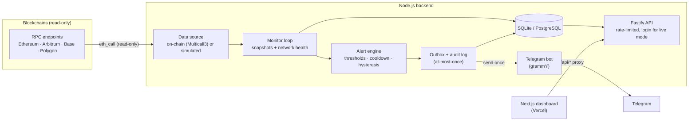
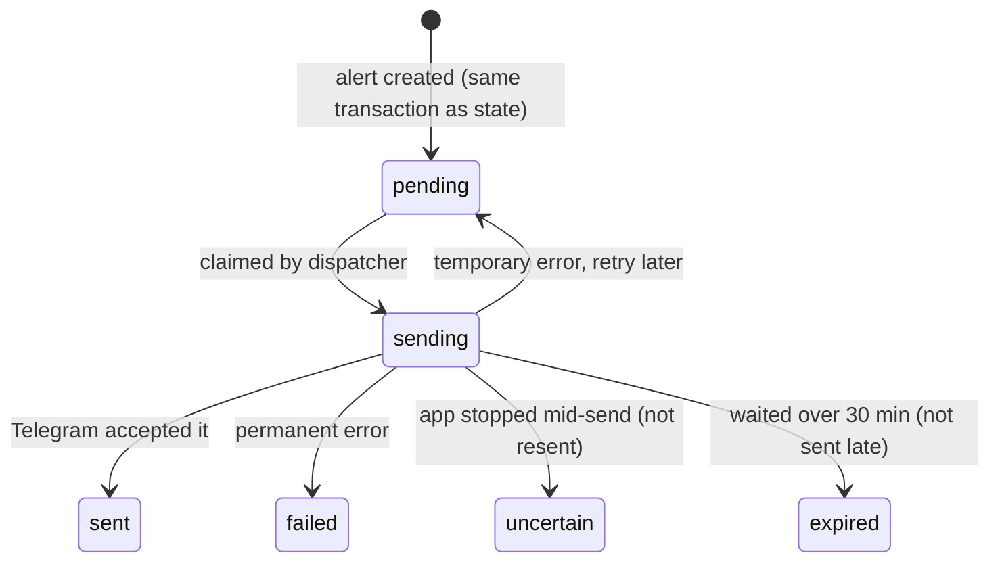

# Aave Position Guardian

**A read-only, non-custodial early-warning monitor for Aave V3 borrowers.**
It watches the health factor of wallets on Ethereum, Arbitrum, Base and Polygon, and sends Telegram
alerts before the liquidation risk grows. A web dashboard shows positions, health-factor history,
alerts and network health.

**Live demo (simulated data only):** [aave-position-guardian.vercel.app](https://aave-position-guardian.vercel.app)
The backend runs on a free host that sleeps. The first visit can take about a minute to wake up.

> [!WARNING]
> **Not financial advice. Not audited. No guarantee.** This is a portfolio project. Alerts can be
> **delayed or fail**: RPC outages, a sleeping host, Telegram problems. It **cannot guarantee** that
> you avoid liquidation. Keep your own safety margin and do not rely on it alone.

> [!IMPORTANT]
> **Read-only. No keys, ever.**
> - The code contains **no** private keys, seed phrases or transaction-signing code.
> - It only makes **read-only** calls (`eth_call`, `eth_blockNumber`). It cannot move funds.
> - You only enter **public wallet addresses**. If anything asks you for a seed phrase, it is a scam.
>   The bot deletes messages that look like a seed phrase and warns the user.

---

## Contents

- [Features](#features)
- [How it works](#how-it-works)
- [Alert logic](#alert-logic)
- [The what-if estimate](#the-what-if-estimate)
- [Testing and validation](#testing-and-validation)
- [Quick start (demo)](#quick-start-demo)
- [Security](#security)
- [Limits](#limits)
- [How I built it](#how-i-built-it)
- [License](#license)

## Features

| Area | What it does |
|---|---|
| **Data** | Official Aave V3 reads (`Pool.getUserAccountData`, data provider, oracle) batched through Multicall3, with caching, retries and rate limiting. Contract addresses come from the official Aave address book and are verified on-chain before use. |
| **Alerts** | Multiple thresholds (default 1.5 / 1.25 / 1.1), de-duplication, cooldown, hysteresis, a "recovered" message, repeated critical alerts, and a "data problem" warning when reads keep failing. |
| **Delivery** | A transactional outbox: every alert is sent **at most once**, even across restarts. An audit log records each decision. |
| **Telegram bot** | grammY. `/add`, `/remove`, `/list`, `/status`, `/thresholds`, `/settings`, `/pause`, `/resume`, `/networks`, `/demo`, `/help`. |
| **Dashboard** | Next.js + Recharts: positions, HF chart with thresholds, the what-if card, alerts and audit log, network health, and a login for live mode. |
| **What-if** | An estimate of how far the main collateral's price can fall before HF reaches 1. Clearly labelled, with its formula and limits. |
| **Demo mode** | Simulated positions, including a "liquidation drill" that falls toward HF 1.09 and recovers every 30 minutes. The public deployment is demo-only. |
| **Storage** | SQLite for local use, PostgreSQL for hosting. Both pass the same contract tests. |

## How it works



1. The **monitor** reads every watched position on a fixed interval. A failed read is stored as
   **stale**, with its age, and is never shown as fresh.
2. The **alert engine** is a pure function: `(previous state, new reading, settings) → (new state, events, audit)`.
   It is easy to test and has no side effects.
3. The new state and the alerts it produced are saved **in one database transaction** into an outbox.
4. The **dispatcher** claims due alerts, sends them, and records the result.

### Surviving a sleeping or crashing host



- Each alert has a deterministic id (position, kind, level, time), so the same event saved twice is stored once.
- An alert interrupted mid-send is marked `uncertain` and is not resent. A missed alert is
  preferred over a duplicate, and the audit log shows what happened.
- An alert that waited more than 30 minutes (for example while the host slept) is expired rather
  than sent late with outdated numbers.
- A test restarts the app in the middle of the liquidation drill and checks that exactly 4 alerts
  are sent, with no duplicates, on both SQLite and PostgreSQL.

## Alert logic

Default settings (each user can change them):

| Setting | Default | Meaning |
|---|---|---|
| Thresholds | 1.5 / 1.25 / 1.1 | The last one is **critical**. |
| Hysteresis | 0.05 | Below 1.25, HF must rise above 1.30 to count as recovered from that level. No flapping. |
| Cooldown | 30 min | The same level stays silent for this long after an alert. |
| Critical repeat | 30 min | While critical, the alert repeats. It repeats sooner if HF falls another 0.05. |
| Data problem | 15 min | Warn the user if reads have failed for this long: "monitoring is blind". |

The health factor, collateral, debt, liquidation threshold and LTV come straight from Aave's
`getUserAccountData`. **This project does not recompute Aave's math.** Its own calculation is used
only for the labelled what-if estimate.

## The what-if estimate

> "About how far can the main collateral's price fall before HF reaches 1?"

```
Aave:  HF = (TotalCollateral × LT_avg) / TotalDebt
s     = value of the largest collateral asset / TotalCollateral
drop  ≈ (1 − 1/HF) ÷ s
```

**Limits:** it is exact for a single collateral asset and approximate for mixed collateral. It
assumes the other prices and the debt stay the same, and it ignores interest, oracle delays and
parameter changes. Liquidation can happen earlier. The dashboard and the bot always show these
limits next to the number.

## Testing and validation

All numbers below come from runs in this repository.

| Check | Result |
|---|---|
| Unit and integration tests (Vitest) | **152 / 152 passing** |
| Fork validation: Ethereum fork, block 26502317 | **30 / 30 checks** |
| Fork validation: Arbitrum fork, block 527842374 | **34 / 34 checks** |
| What-if, single collateral, on the fork | Aave's own HF was **1.0000** at our estimated price in **7 of 7** cases |

- **Fork validation** (`npm run fork:validate`) starts a local Anvil fork, reads real borrowers
  with this project's reader, and compares against Aave's own `getUserAccountData`:
  - HF matches exactly;
  - collateral and debt totals match;
  - the per-asset breakdown is within 0.1% or $0.01;
  - two reads are identical.

  It then sets the collateral's oracle price **on the local fork only** to our estimated liquidation
  price, and checks that Aave reports HF ≈ 1. Nothing is ever sent to a real network.
- The fork runs are **recorded as fixtures** and replayed in the normal test suite, so CI needs no RPC.
- The **store tests** run the same contract against SQLite and PostgreSQL (PGlite, real Postgres in WebAssembly).
- **No real money** is used anywhere. Tests use recorded fixtures, a read-only mainnet fork and
  simulated data.

## Quick start (demo)

Requires Node.js 22.13+ and Git. On Windows, run these in PowerShell:

```powershell
git clone https://github.com/Abdou293/aave-position-guardian.git
cd aave-position-guardian
npm ci
npm --prefix dashboard ci
Copy-Item .env.example .env
npm run dev
```

In a second terminal:

```powershell
npm run dashboard:dev
```

Open http://localhost:3000. Demo mode needs no keys. To get Telegram alerts, put your own bot token
from @BotFather into `.env` (never into the code or a chat), restart, and send `/demo` to your bot.

- Real use (live mode): [docs/LIVE-SETUP.md](docs/LIVE-SETUP.md)
- Free deployment of the demo: [docs/DEPLOY.md](docs/DEPLOY.md)
- Final security checklist: [docs/SECURITY-CHECKLIST.md](docs/SECURITY-CHECKLIST.md)

### Useful commands

| Command | What it does |
|---|---|
| `npm test` | Run all tests |
| `npm run verify:addresses` | Verify every Aave V3 and Multicall3 address on-chain |
| `npm run fork:validate` | Compare against Aave on local forks (needs Anvil) |
| `npm run scan:all` | Secret scan of the folder and the whole Git history (gitleaks) |
| `npm run hash:password` | Create the dashboard admin password hash (live mode) |

## Security

- **Read-only:** no private keys, no seed phrases, no signing code, no transactions.
- **Secrets:** only in `.env`, which Git ignores from the first commit. `.env.example` contains placeholders only.
- **Secret scanning:** gitleaks runs as a pre-commit hook and before every push, on the folder and
  the whole Git history.
- **Verified addresses:** every address comes from the official Aave address book and Multicall3,
  and is checked on-chain. A network whose addresses cannot be verified is not used.
- **Inputs:** wallet addresses are validated with their checksum. The API body size is limited.
- **API:**
  - rate limits (120 requests/min; login 5/min per IP), plus a global lock after repeated failed logins;
  - admin password hashed with scrypt;
  - HMAC-signed session cookie (HttpOnly, SameSite=Strict, Secure when hosted);
  - security headers; error messages that hide internals.
- **Privacy:** Telegram chat ids are never returned by the API. The logger never writes tokens, RPC keys or message contents.

Details: [docs/SECURITY-CHECKLIST.md](docs/SECURITY-CHECKLIST.md).

## Limits

To be clear about what this project is and is not:

- **Not audited**, not production-hardened, and **no guarantee** of preventing liquidation.
- **Free hosts sleep.** While the host sleeps, nothing is monitored. The public demo also loses its
  data on every restart, because it runs without a database.
- **Public RPCs** are shared and can be slow or rate-limited. Use your own RPC for real use.
- **At-most-once delivery:** an alert interrupted mid-send is not resent. This is safer against
  spam, but it can miss an alert.
- The **what-if** number is an approximation for mixed collateral.
- **Aave V3 only**, on four networks: Ethereum, Arbitrum, Base and Polygon.

## How I built it

I built this project with an **AI coding assistant (Claude Code)** as a pair programmer. I directed
the work in seven phases and reviewed and approved each one before the next began:

1. Foundations: repository, secret scanning, on-chain address verification.
2. Data layer: one data-source interface, a Multicall3 reader, and a simulated source.
3. Alert engine.
4. Telegram bot and database.
5. Dashboard and API.
6. Fork validation, PostgreSQL, deployment.
7. Documentation.

The rules I set from the start:

- read-only only;
- no secrets in code;
- gitleaks before every commit and push;
- never guess a contract address; verify each one on-chain;
- use Aave's own values instead of re-implementing its math;
- be honest about limits, and report only numbers that the tests actually produced.

I ran every step on my own machine and tested the bot and the alerts live in Telegram. I made the
key decisions, for example:

- **at-most-once delivery** instead of risking duplicates;
- **expiring late alerts** after a host wakes up;
- **demo-only** public hosting.

## License

[MIT](LICENSE). Provided "as is", without warranty of any kind. See the disclaimer at the top.
